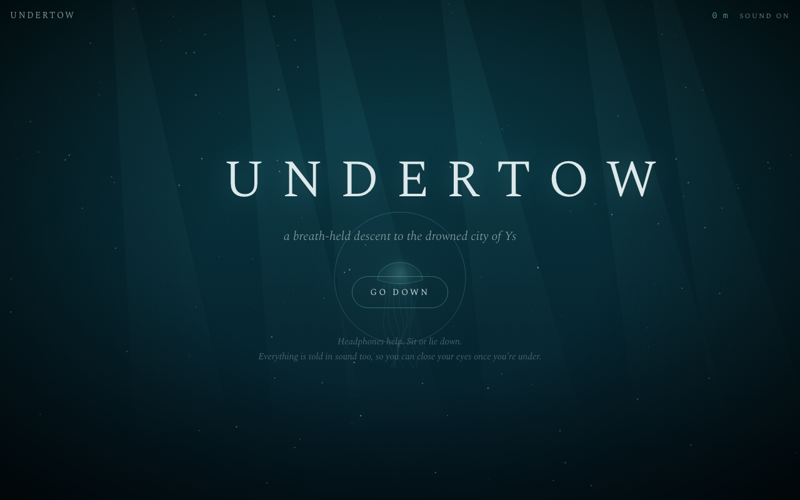

# Undertow

*A breath-held descent to the drowned city of Ys.*



Undertow is an atmospheric, seven-chapter browser game about guided breathing and breath-hold practice, set in the drowned city of Ys. You dive into Ys, the city of Breton legend that drowned under the Bay of Douarnenez. There, snow falls upward, the cathedral breathes with you, and every chapter is a real breathing or breath-hold technique wrapped in a strange, dreamlike story.

It is a single HTML file with no build step, no dependencies, and no audio files. All sound (drones, bells, a sleeping choir, a pipe organ, your slowing heartbeat) is synthesized live with the Web Audio API.

> **Dry practice only.** Never do breath-hold training in or near water, in the bath, while driving, or standing. See [Safety](#safety).

---

## Play

Open `index.html` in a modern browser (Chrome, Edge, Firefox or Safari). That's it.

For the best experience:

- wear **headphones**
- **sit or lie down**
- once you're under, you can **close your eyes**: every cue is also given in sound

To host it, push the repo to GitHub and enable **GitHub Pages** (Settings → Pages → deploy from branch, root folder). `index.html` is served as-is.

## Controls

| Action | Keyboard | Touch |
|---|---|---|
| Breathe in / hold full (in the guided chapters) | hold **Space** | press and hold the screen |
| Breathe out / hold empty | release **Space** | lift your finger |
| Start / end a measured hold | tap **Space** | tap the screen |
| Mark a contraction | **C** | *contraction* button |
| Breathe early during a table hold | **Space** | *I need to breathe* button |
| Mute / unmute | **M** | *sound* in the top bar |
| Surface early (leave the chapter) | **Esc** | *surface early* button |

## The descent

Seven chapters, each unlocked by the one before it.

| | Chapter | Technique | Length |
|---|---|---|---|
| I | **The Bay of Douarnenez** | Long-exhale breathing, 4 in / 6 out | ~2 min |
| II | **The Gate of Dahut** | Box breathing, 4 · 4 · 4 · 4 | ~2 min |
| III | **The Choir of Sleepers** | 4-7-8 breathing. Halfway through, the light fades and you follow the choir by ear. | ~1½ min |
| IV | **The Belfry** | Relaxed static apnea: one measured hold that becomes your baseline | ~4 min |
| V | **The Crypt of Clocks** | CO₂ tolerance table | ~10 min |
| VI | **The Organ of Tides** | O₂ table | ~12–15 min |
| VII | **Ys** | Resonance breathing at your own pace, then one last hold | open-ended |

### What each technique does

- **Long exhale (I).** Your heart speeds up slightly on the in-breath and slows on the out-breath (respiratory sinus arrhythmia). Breathing out for longer than you breathe in tips your nervous system toward rest.
- **Box breathing (II).** Equal counts of inhale, hold, exhale and hold. Pilots, surgeons and divers use it to steady their attention under pressure. It also teaches you to be still with full lungs and with empty ones.
- **4-7-8 (III).** A hold longer than the inhale and an exhale longer than both. It's a strong downshift that people often use to fall asleep.
- **Static apnea (IV).** A calm 72-second breathe-up, one full breath, then a relaxed hold that you stop at the first strong urge, not at your limit. The game animates a slowing heartbeat during the hold; it does not measure your actual heart rate.
- **CO₂ table (V).** Six rounds. Each hold is fixed at about 50% of your baseline, and the rest shrinks from 1:45 to 0:30. It builds tolerance to rising carbon dioxide, which is what actually makes you feel you must breathe.
- **O₂ table (VI).** Six rounds. The rest is fixed at 1:30 and the holds climb from about 40% to 75% of your baseline. It gets you used to longer holds.
- **Resonance breathing (VII).** Around six breaths a minute, which for most people lines up the heart's rhythm with the breath. Nothing paces you here; the game measures your own rhythm and responds to it.

### Feedback

- **Concord**: in the guided chapters, the share of time you pressed in step with the guide.
- **First contraction**: tap C when your diaphragm starts to twitch. Over weeks of practice it tends to arrive later.
- **Bells**: during holds, a bell tolls once per half minute (one toll at 0:30, two at 1:00, and so on), so you can keep track with your eyes closed.

## After the story

Once you've reached the end, Undertow becomes a nightly practice:

- Any completed chapter can be replayed from the map.
- The **logbook** shows your best relaxed hold, your history, the number of nights you've practiced, and the date your baseline was set. You can also enter your baseline by hand.
- A **Tonight** card suggests a session: it alternates CO₂ and O₂ tables, sends you back to the Belfry if your baseline is more than a week old, and steers you to a gentle chapter if you've already done a table today.
- The screen is kept awake during a session (Screen Wake Lock), so it doesn't sleep while your eyes are closed.

## Safety

Undertow is a calm, dry training aid. It is **not medical advice** and **not a substitute for free-diving instruction**.

- **Never** practice breath holds in or near water, in the bath, while driving, or standing. Shallow-water blackout happens without warning.
- Sit or lie down somewhere safe.
- **Don't hyperventilate** before a hold. Calm breaths only.
- **Never push toward blackout.** Contractions are normal; dizziness, tingling or tunnel vision mean stop and breathe.
- Do at most **one table a day**, and never a CO₂ table and an O₂ table back to back.
- Skip the breath-hold chapters (IV–VII) if you are pregnant or have a heart, lung or blood-pressure condition, or epilepsy. Chapters I–III are gentle breathing and suit most people.

The game shows these rules before your first dive.

## Under the hood

- **One file**: `index.html` with inline CSS and vanilla JavaScript. No frameworks, no build.
- **Sound**: Web Audio API. Convolution reverb from a generated impulse response, a lowpass "underwater" bus, inharmonic bell partials, formant-filtered sawtooth voices for the choir, additive pipe-organ tones, and a synthesized heartbeat that slows during holds.
- **Visuals**: a single `<canvas>` with gothic arches drifting toward you in perspective, a jellyfish lantern that shows the breath, upward-falling marine snow, and per-chapter set pieces (clock face, organ pipes, the bell).
- **Persistence**: `localStorage` under the key `undertow.v1`. Progress stays in your browser, and the game has no analytics. Google Fonts requests are external; see Fonts below.
- **Fonts**: Spectral and IBM Plex Mono from Google Fonts. Offline, it falls back to Georgia and the system monospace font.
- **Testing**: add `?fast` to the URL (`index.html?fast`) to run every timer 15× faster.

## Project structure

```
Undertow/
├── index.html      # the whole game
├── README.md
└── docs/
    └── title.png   # screenshot used above
```

## Credits

- The story draws on the Breton legend of **Ys** and **Princess Dahut**, who opened the sluice gates with a stolen silver key. The closing line borrows the old saying that when Paris sinks, Ys will rise again.
- Training structure is based on the standard CO₂ and O₂ static apnea tables used in free-diving.

## License

No license has been specified for this project.
